<picture>
  <source media="(prefers-color-scheme: dark)" srcset="assets/header-dark.svg">
  
</picture>

  
  
  

I like making LLMs fast and useful: profiling where the milliseconds go, tuning how models get served, and building agents people actually use.

MS CS (AI) from Arizona State · Engineering intern at OpsCien · 🏆 1st place, Build Personal Agents Hack (SF Tech Week 2026)

---

### ⚡ [gpu-programming](https://github.com/sudhersankv/gpu-programming) — my main lab

Where I learn GPU programming and LLM inference by building, benchmarking and profiling everything myself. Some results from it:

<picture>
  <source media="(prefers-color-scheme: dark)" srcset="assets/bench-dark.svg">
  
</picture>

**→ [Read the case study: Profiling vLLM automatic prefix caching](https://sudhersankv.github.io/gpu-programming/)** (client timings + Nsight Systems traces)

<b>LLM Inference Runtime Lab</b> · HF vs vLLM, prefix caching, Nsight profiling, LMCache

 

A benchmark harness I built to compare inference engines on the same model and prompts, reporting TTFT, end-to-end latency and tok/s at p50–p99.

- Hugging Face and vLLM (Docker) baselines with an OpenAI-compatible streaming client
- Reproducible shared-prefix workload built from the Qasper dataset, plus a control set with no shared prefix
- vLLM automatic prefix caching A/B, then traced with Nsight Systems down to kernel and memcpy level
- LMCache smoke test. Coming next: SGLang, TensorRT-LLM, ROCm, Nsight Compute

[`llm-inference-runtime-lab/`](https://github.com/sudhersankv/gpu-programming/tree/main/llm-inference-runtime-lab)

<b>Kernel practice</b> · CUDA, Triton, CuTe DSL, JAX, Mojo

 

Hands-on kernel lessons: launches, indexing, memory, matmul and reduction, done through LeetGPU so no local GPU is needed for the practice loop.

[`leetgpu/`](https://github.com/sudhersankv/gpu-programming/tree/main/leetgpu)

<b>Agentic Inference Optimization</b> · in progress

 

A long-term project: watch real LLM inference on a GPU, figure out why it behaves the way it does, then use agents to propose and test optimizations. I'm currently tracing the full path from a cloud GPU to generated tokens (model loading, request lifecycle, KV cache, vLLM execution) before writing any agent code.

[`agentic-inference-optimization/`](https://github.com/sudhersankv/gpu-programming/tree/main/agentic-inference-optimization)

---

### More work

<b>🏆 Kevin from Home Alone</b> · 1st place, Build Personal Agents Hack

 

A shared household agent that lives in your group chat and helps everyone in the home stay on the same page. Built at the SF Tech Week kickoff hackathon.

<b>LLM fine-tuning & serving</b> · LoRA / QLoRA on Qwen, served with vLLM

 

Fine-tuned Qwen models with LoRA/QLoRA (Unsloth) and served them on vLLM, benchmarking speed and generation quality side by side.

<b>LLM-guided ASIC physical design</b> · OpenROAD

 

Put an LLM in the loop of OpenROAD's flow to steer timing optimization during ASIC physical design.

<b>Legal AI</b> · domain-specific language models

 

Building legal-domain models through phrase mining, graph analysis and instruction tuning.

---

### Toolbox

  

**Inference & GPU:** vLLM · CUDA · Triton · ROCm/HIP · Nsight Systems · ONNX Runtime · LMCache

**ML:** PyTorch · Hugging Face Transformers · LoRA/QLoRA · Unsloth · OpenCV
